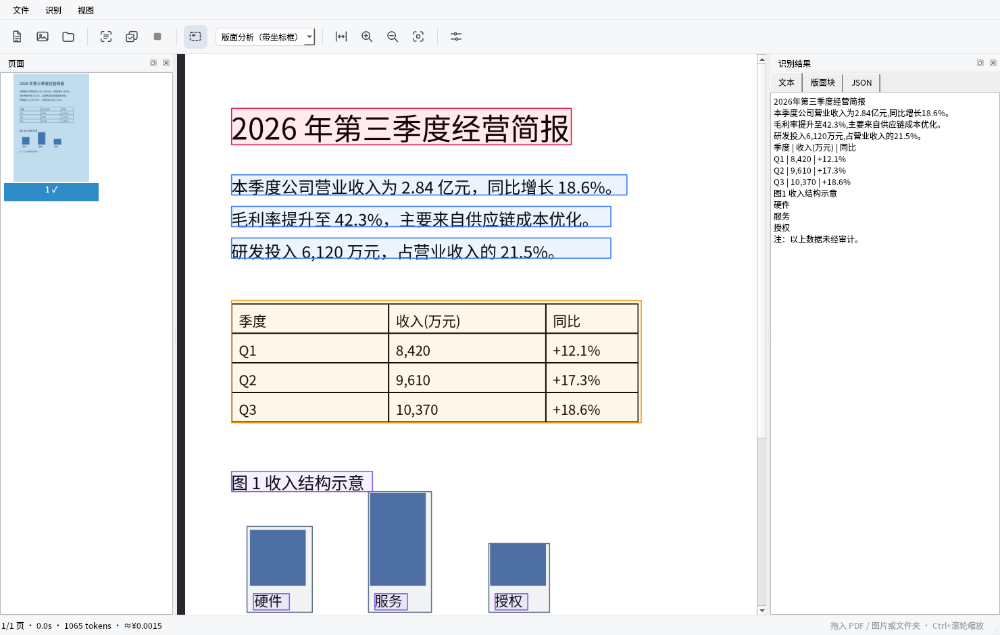

# docr-qt



DeepSeek OCR 的 Qt 6 桌面前端：导入 PDF 或图片序列，逐页调用
`POST /v1/tools/ocr`，把返回的 `<|ref|>/<|box|>` 版面坐标叠加显示在页面上。

## 验证结果（2026-11-17）

用合成测试页（1240×1754，含标题、三段正文、4×3 表格、柱状图、脚注）实测：

| purpose | 耗时 | 返回 | 备注 |
|---|---|---|---|
| `text_recognition` | 2.7 s | Markdown + `<table>`，无坐标 | 643/238 tokens |
| `rich_layout_recognition` | 2.8 s | 13 个带坐标的块 | 658/407 tokens，坐标 0–1000 归一化 |

原始响应保存在 `out/`，可离线复现界面（见 `--mock`）。

截图即真实调用结果：整页 2.7 s、1065 tokens、约 ¥0.0015。

## 依赖

- Qt 6（Widgets、Network、Gui）
- poppler-qt6（PDF 逐页渲染，开发包）
- CMake ≥ 3.21、C++20 编译器

Debian/Ubuntu 参考：`qt6-base-dev libpoppler-qt6-dev cmake g++`

## 构建

```bash
cmake -S . -B build -DCMAKE_BUILD_TYPE=Release
cmake --build build -j
./build/docr-qt
```

## 界面

工具栏为纯图标（悬停显示名称与快捷键），每个动作在菜单里也有文字入口：

| 图标 | 动作 | 快捷键 |
|---|---|---|
| 文档 / 图片 / 文件夹 | 打开 PDF / 图片 / 目录 | `Ctrl+O` / `Ctrl+Shift+O` / — |
| 扫描框 / 叠页 | 识别本页 / 识别全部 | `Ctrl+R` / `Ctrl+Shift+R` |
| 实心方块 | 停止 | `Esc` |
| 虚线框 | 显示/隐藏识别框 | — |
| 双向箭头 / ± 放大镜 / 角标 | 适应宽度 / 放大 / 缩小 / 原始大小 | `F` / `Ctrl++` / `Ctrl+-` / — |
| 滑杆 | 设置 | `Ctrl+,` |

图标为手写的 24×24 线性 SVG（`assets/icons/`），应用图标是深色圆角方块 + 扫描角标
（`assets/app.svg`）。`cmake --install` 会把图标装到 `share/icons/hicolor/scalable/apps/docr-qt.svg`，
并安装 `assets/docr-qt.desktop`。

## 使用

- **打开**：拖入 PDF / 图片 / 图片目录，或工具栏「打开 PDF / 打开图片 / 打开文件夹」。
  图片目录按自然序（`page2` 在 `page10` 前）排序。
- **识别**：选择 purpose 后点「识别全部」（`Ctrl+Shift+R`）或「识别本页」（`Ctrl+R`）；
  `Esc` 停止（已发出但未返回的请求会被丢弃）。
- **查看**：左侧页列表带状态（⏳ 进行中 / ✓ 成功 / ✕ 失败）；中间叠加识别框，
  颜色区分类型；悬停显示文本，点击框会在「版面块」表里选中对应行，反之亦然。
- **缩放**：`Ctrl+滚轮` 缩放，`F` 适应宽度，`Ctrl+0` 原始大小。
- **导出**：「文件 → 导出 Markdown / JSON」，或 `Ctrl+C` 复制本页文本。

## 配置

设置对话框（`Ctrl+,`）可改 API Key、接口地址、渲染 dpi、并发数。

API Key 解析顺序：

1. 设置里保存的 Key（勾选「保存到本机设置」时才落盘）
2. `DEEPSEEK_API_KEY` 环境变量
3. `~/.dsh/.credentials.yaml` 中的 `DEEPSEEK_API_KEY`（复用 DSH 凭据库，只读）

## 设计说明

- **逐页上传渲染图，而不是整份 PDF**：进度可见、失败可单页重试、框坐标和本地渲染严格同源。
  代价是每页一次请求（计费按页不变：1.5 元/千页）。
- 渲染默认 150 dpi（A4 ≈ 1240×1754）。dpi 越高小字越准，上传体积也越大。
- 接口上限：单文件 100 MiB、1000 页、总时长 180 s、账号并发 15——并发默认 3，可在设置里调。
- 识别阶段失败可能出现在 **HTTP 200 的响应体**里（`{"error": {...}}`），客户端已单独处理。
- `finish_reason == "length"` 表示该页文本被截断，界面在 JSON 页签可查，不静默丢弃。

## 命令行

```bash
./build/docr-qt --open doc.pdf --ocr                    # 打开并识别全部
./build/docr-qt --open page.png --mock out/rich.json    # 离线预览已保存结果
./build/docr-qt --open page.png --ocr --screenshot ui.png  # 识别完成后截图退出（CI/无头）
```

## 已知限制

- 不支持的输入：加密 PDF、带 DRM 的电子书；音频/视频不在本工具范围。
- 未做整页图像缓存淘汰，超大文档（数百页）常驻内存偏高，后续可加 LRU。
- 版面块表格以 HTML 原样展示，尚未做结构编辑。
