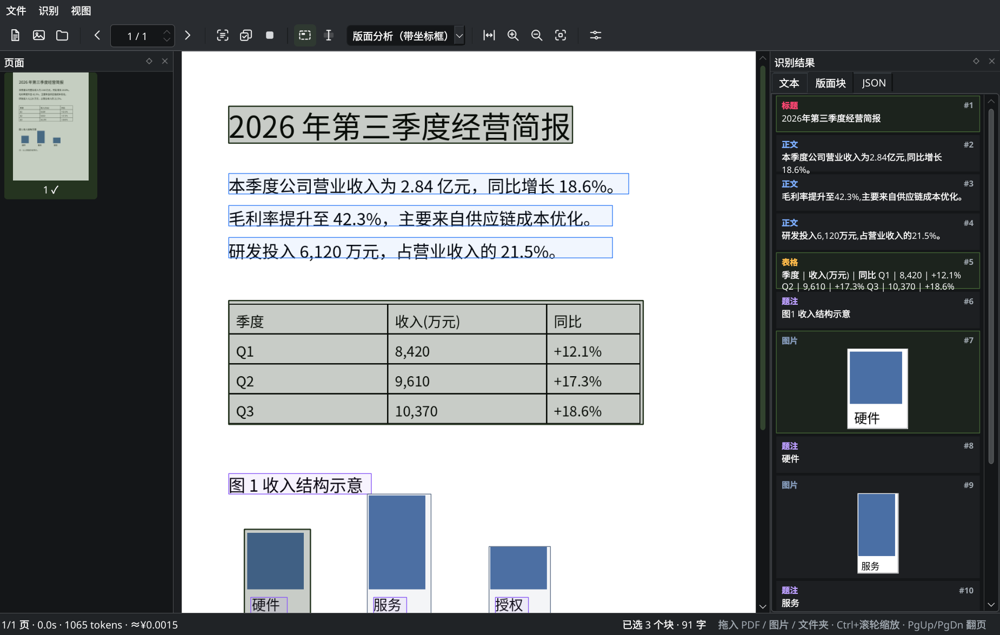
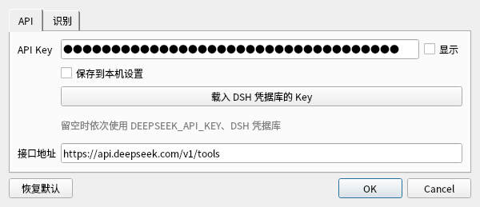
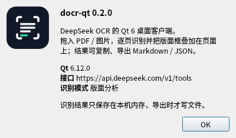
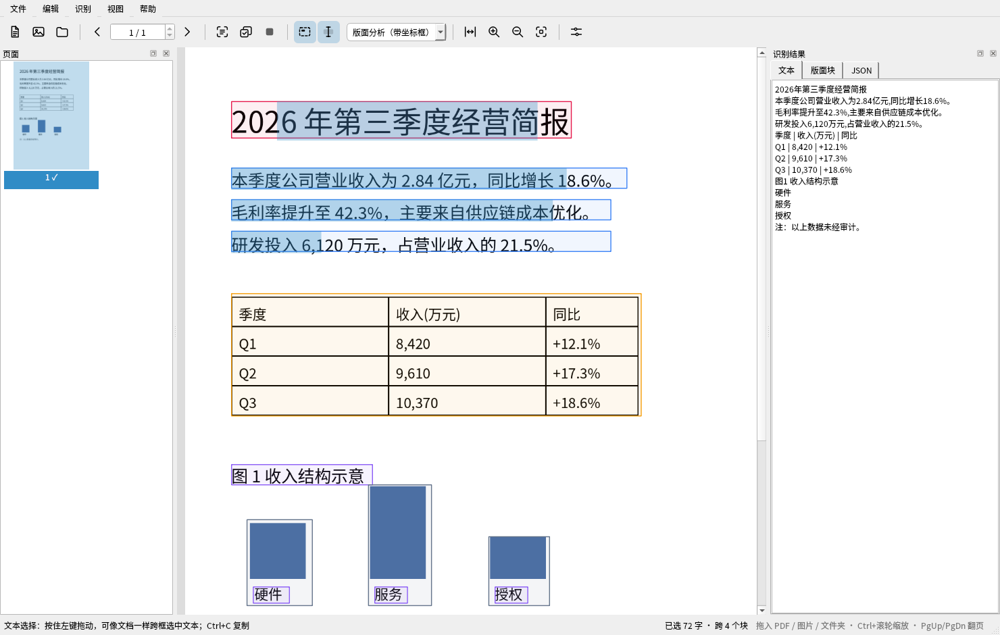

# docr-qt



浅色方案见 `docs/screenshot-light.png`，拖入提示见 `docs/screenshot-drop.png`，
首选项与关于见 `docs/preferences.png`、`docs/about.png`。

DeepSeek OCR 的 Qt 6 桌面前端：拖入 PDF 或图片序列，逐页调用
`POST /v1/tools/ocr`，把返回的 `<|ref|>/<|box|>` 版面坐标叠加显示在页面上。
识别结果按版面块做成卡片列表，支持框选、批量复制与连续选文本。

## 功能

- **拖入即开**：PDF、图片、图片目录都可以直接拖进窗口，可多选、可混排。
- **连续翻页**：工具栏页码框、`PgUp/PgDn`、`Ctrl+PgUp/PgDn`，滚轮滚到页边也会翻页。
- **框选与复制**：单击选中，`Ctrl+点击` 加选，`Ctrl+拖动` 拉框批量选，右键复制。
- **选中文本工具**：开启后拖动可连续选块，`Ctrl` 加选，`Ctrl+C` 复制。
- **版面块卡片**：按类型着色、两行预览；图片块直接显示该区域的页面裁剪图。
- **双向联动**：选中画布上的框会自动切到「版面块」并定位到对应卡片，反之亦然。
- **主题跟随系统**：所有颜色来自 `QPalette`，浅色/深色都不写死颜色。

## 验证结果（2026-11-17）

用合成测试页（1240×1754，含标题、三段正文、4×3 表格、柱状图、脚注）实测：

| purpose | 耗时 | 返回 | 备注 |
|---|---|---|---|
| `text_recognition` | 2.7 s | Markdown + `<table>`，无坐标 | 643/238 tokens |
| `rich_layout_recognition` | 2.8 s | 13 个带坐标的块 | 658/407 tokens，坐标 0–1000 归一化 |

原始响应保存在 `out/`，可离线复现界面（见 `--mock`）。

截图即真实调用结果：整页 2.7 s、1065 tokens、约 ¥0.0015。

## 依赖

- Qt 6（Widgets、Network、Gui）
- poppler-qt6（PDF 逐页渲染，开发包）
- CMake ≥ 3.21、C++20 编译器

Debian/Ubuntu 参考：`qt6-base-dev libpoppler-qt6-dev cmake g++`

## 构建

```bash
cmake -S . -B build -DCMAKE_BUILD_TYPE=Release
cmake --build build -j
./build/docr-qt
```

## 界面

工具栏为纯图标（悬停显示名称与快捷键），每个动作在菜单里也有文字入口：

| 图标 | 动作 | 快捷键 |
|---|---|---|
| 文档 / 图片 / 文件夹 | 打开 PDF / 图片 / 目录 | `Ctrl+O` / `Ctrl+Shift+O` / — |
| `‹` / `›` + 页码框 | 上一页 / 下一页 / 跳转页码 | `Ctrl+PgUp` / `Ctrl+PgDn` / 输入后回车 |
| 扫描框 / 叠页 | 识别本页 / 识别全部 | `Ctrl+R` / `Ctrl+Shift+R` |
| 实心方块 | 停止 | `Esc` |
| 虚线框 | 显示/隐藏识别框 | — |
| I 形光标 | 选中文本工具 | — |
| 双向箭头 / ± 放大镜 / 角标 | 适应宽度 / 放大 / 缩小 / 原始大小 | `F` / `Ctrl++` / `Ctrl+-` / `Ctrl+0` |
| 滑杆 | 首选项 | `Ctrl+,` |

图标为手写的 24×24 线性 SVG（`assets/icons/`），描边用 `currentColor`，运行时按
`QPalette::WindowText` 染色，浅色/深色下都保持对比度；应用图标是深色圆角方块 + 扫描角标
（`assets/app.svg`，带浅色描边以便在深色标题栏上可辨）。`cmake --install` 会把图标装到 `share/icons/hicolor/scalable/apps/docr-qt.svg`，
并安装 `assets/docr-qt.desktop`。

## 首选项与关于

「编辑 → 首选项…」（`Ctrl+,`）分两页：

- **API**：设置 Key、显示/隐藏、从 DSH 凭据库载入、是否保存到本机、接口地址；
  留空时按环境变量、DSH 凭据库的顺序回退。
- **识别**：默认 purpose、渲染 dpi、并发数。



「帮助 → 关于 docr-qt」显示版本、Qt 版本、接口地址和当前识别模式；「关于 Qt」是 Qt 自带的
版本信息。



## 使用

### 打开

- 把 PDF / 图片 / 文件夹直接拖进窗口，窗口中间会出现「松开以打开」提示。
- 一次拖入多个文件、多个目录或 PDF 与图片混合都可以；按拖入顺序拼接页序。
- 目录内的图片按自然序排序（`page2` 在 `page10` 前）。
- 也可以走工具栏「打开 PDF / 打开图片 / 打开文件夹」。

### 翻页

- 工具栏中间是页码框，显示 `当前页 / 总页数`，输入页码后回车跳转。
- `PgUp` / `PgDn`：先在当前页内滚动，滚到页顶/页底后再翻页（和常见阅读器一致）。
- 鼠标滚轮同理：页内滚到底后再往下滚就翻到下一页，触控板惯性有节流。
- `Ctrl+PgUp` / `Ctrl+PgDn` 或工具栏 `‹` `›` 直接翻页；翻页后自动回到页首。

### 选择与复制

- 单击识别框选中；`Ctrl+点击` 加选/取消；在空白处按下 `Ctrl` 拖动可拉框批量选。
  从某个框上开始 `Ctrl+拖动` 也可以，不会误触单个框。
- 选中框时右侧会自动切到「版面块」并滚动到对应卡片；在卡片列表里多选也会同步高亮画布。
- `右键` 任意框 → 「复制」；多选时复制全部选中块，块之间按阅读顺序拼接。
- `Ctrl+C` 复制选中块（没有选中时退回复制本页文本）；`Ctrl+Shift+C` 始终复制本页文本。
- `Esc` 清空选择。

### 选中文本工具

工具栏的 I 形光标按钮（或「视图 → 选中文本」）开启后，行为接近文档编辑器：

- 在文字上按下左键拖动，按字符选中；起止点可以在不同的版面块里，
  中间跨过的块自动整段选中；
- 高亮按每块内的文本排版逐行绘制，支持只选中某一行的一部分；
- `Ctrl+C` 或右键「复制选中文本」复制**精确的子串**；`Esc` 取消；
- 选择文本时不会自动切到右侧卡片，和整块选择互不干扰。



OCR 只提供块级坐标，行内高亮位置是按块框和文本重新排版估算的，可能和扫描件字形有
几像素偏差；复制出来的文字不受影响，是精确的字符区间。

### 版面块卡片

- 每张卡片一行类型标签 + 两行文本预览，紧凑排列，无圆角。
- 类型用左侧色条和标签区分（标题/正文/表格/题注/图片/脚注/公式）。
- 图片类块会把页面上的对应区域裁剪出来，按比例居中显示，占据卡片主体。
- 单击卡片 → 选中并在画布上定位；`Ctrl+点击` 多选；右键复制。

### 识别、缩放、导出

- 选择 purpose 后点「识别全部」（`Ctrl+Shift+R`）或「识别本页」（`Ctrl+R`）；
  `Esc` 停止（已发出但未返回的请求会被丢弃）。
- 点「识别本页」会立刻在页列表标 `⏳`、状态栏显示“正在识别第 N 页”，不会静默排队。
- 左侧页列表带状态（⏳ 进行中 / ✓ 成功 / `!` 空结果 / ✕ 失败）。
- 缩放：`Ctrl+滚轮`，`F` 适应宽度，`Ctrl+0` 原始大小。
- 「文件 → 导出 Markdown / JSON」。

## 主题

界面不写死颜色：工具栏、菜单栏、状态栏、下拉框、卡片和识别框高亮全部取自当前 `QPalette`
（分隔线用 `Mid`，悬停/选中用 `Highlight` 的透明度变体），跟随系统浅色/深色方案。
运行时切换系统主题会收到 `ApplicationPaletteChange`，图标与样式表即时重建。

调试时可用 `--dark` / `--light` 强制方案（需要平台支持 `QStyleHints::setColorScheme`）。

## 配置

首选项（`Ctrl+,`，见上文）可改 API Key、接口地址、默认 purpose、渲染 dpi、并发数。

API Key 解析顺序：

1. 设置里保存的 Key（勾选「保存到本机设置」时才落盘）
2. `DEEPSEEK_API_KEY` 环境变量
3. `~/.dsh/.credentials.yaml` 中的 `DEEPSEEK_API_KEY`（复用 DSH 凭据库，只读）

## 识别异常与诊断

服务端偶尔会在 HTTP 200 里返回**空结果**：`pages[0].text == ""`、`finish_reason == "stop"`，
`usage` 只有输入 token（例如一页 356 个输入 token、0 个输出 token）。这不是“空白页”：
实测空白页也会返回一个覆盖整页的 `image` 块和 15 个输出 token。因此客户端不应把它当成
成功。

现在的处理：

1. 如果页面有墨迹但结果没有文字、没有版面块，自动重试一次；
2. 页列表先显示 `↻`，重试成功则恢复正常 `✓`；
3. 重试仍为空时标 `!`，状态栏给出说明；
4. 同时把**原始响应、精确上传的页面 PNG、元数据**（页码、purpose、dpi、usage、
   finish_reason、接口地址）保存到 `~/.cache/docr-qt/ocr-empty/`，状态栏会显示路径；
5. 空白页（没有墨迹）不重试、不报警，只提示“没有文字（空白页）”。

这些文件足以判断是服务端空生成、结果被截断，还是输入本身有问题；如果再次遇到，可以把
对应目录里的 `.json` / `.png` 发出来分析。

## 代码结构

| 文件 | 职责 |
|---|---|
| `document.*` | PDF / 图片模型，按需渲染与缩略图 |
| `ocr.*` | DeepSeek OCR 客户端、multipart 组包、标记解析 |
| `ocrqueue.*` | OCR 并发队列、取消、空结果自动重试 |
| `pageview.*` | 画布、识别框、Ctrl 框选、字符级文本选择 |
| `blockcards.*` | 「版面块」卡片列表与图片裁剪 |
| `preferences.*` | 首选项对话框与关于对话框 |
| `exporters.*` | Markdown / JSON 导出 |
| `ocrdiagnostics.*` | 空结果诊断（原始响应、上传图、元数据）落盘 |
| `theme.*` | QPalette 派生颜色、SVG 图标染色 |
| `mainwindow.*` | 窗口编排：工具栏、菜单、dock、页面/结果/选择同步 |

`mainwindow.cpp` 仍是组装层，保留较多 Qt 控件接线；OCR 调度、对话框、导出、诊断等
独立职责已拆到上面的模块。

## 设计说明

- **逐页上传渲染图，而不是整份 PDF**：进度可见、失败可单页重试、框坐标和本地渲染严格同源。
  代价是每页一次请求（计费按页不变：1.5 元/千页）。
- **多 PDF 混排**：每页持有对应 `Poppler::Document` 的 `shared_ptr`，所以拖入多个 PDF 或
  PDF + 图片可以按顺序拼成一个文档，而不是只支持单个 PDF。
- **拖入事件用应用级过滤器兜底**：`QPlainTextEdit`、`QListWidget` 等子控件默认会接受拖放，
  在主窗口上装 `qApp` 事件过滤器，保证在任何子控件上松手都能打开文件。
- **空结果不能算成功**：结果只校验 JSON 结构会让零输出被标成 `✓`，用户看到的就是“点了没反应”；
  现在按“有墨迹 + 无文本/无块”判定并重试，仍失败则保留原始响应用于诊断。
- **图片卡片裁剪**：用块坐标（0–1000 归一化）在整页渲染图上取并集矩形，按比例缩放到卡片里，
  不改动原图，也不额外请求。
- 渲染默认 150 dpi（A4 ≈ 1240×1754）。dpi 越高小字越准，上传体积也越大。
- 接口上限：单文件 100 MiB、1000 页、总时长 180 s、账号并发 15——并发默认 3，可在设置里调。
- 识别阶段失败可能出现在 **HTTP 200 的响应体**里（`{"error": {...}}`），客户端已单独处理。
- `finish_reason == "length"` 表示该页文本被截断，界面在 JSON 页签可查，不静默丢弃。

## 命令行

```bash
./build/docr-qt --open doc.pdf --ocr                    # 打开并识别全部
./build/docr-qt --open a.pdf --open b.png               # 多文件混排（--open 可重复）
./build/docr-qt --open page.png --mock out/rich_layout_recognition.json
./build/docr-qt --open page.png --mock out/rich_layout_recognition.json --select 0,1,2
./build/docr-qt --open page.png --mock out/rich_layout_recognition.json --text-select 0,80
./build/docr-qt --open doc.pdf --page 5 --ocr-current --screenshot page5.png  # 只识别当前页
./build/docr-qt --open page.png --ocr --screenshot ui.png  # 识别完成后截图退出（CI/无头）
```

`--select 0,1,2` 选中第 1 页的指定块（调试用，便于截图/回归），
`--text-select 0,80` 按全局字符偏移选中一段文本，`--page N` 启动后跳到第 N 页，
`--ocr-current` 只识别当前页，`--drop-hint` 强制显示拖入提示框。

## 已知限制

- 不支持的输入：加密 PDF、带 DRM 的电子书；音频/视频不在本工具范围。
- 文本选择的高亮是按块框重新排版估算的，和扫描件字形可能有几像素偏差；复制内容精确。
- 阅读顺序按块左上角排序（同一行再按 x），多栏文档的跨栏复制顺序可能不理想。
- 图片卡片依赖块坐标；`text_recognition` 模式没有坐标，只显示文本。
- 未做整页图像缓存淘汰，超大文档（数百页）常驻内存偏高，后续可加 LRU。
- 版面块表格以 HTML 原样展示，尚未做结构编辑。
